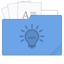
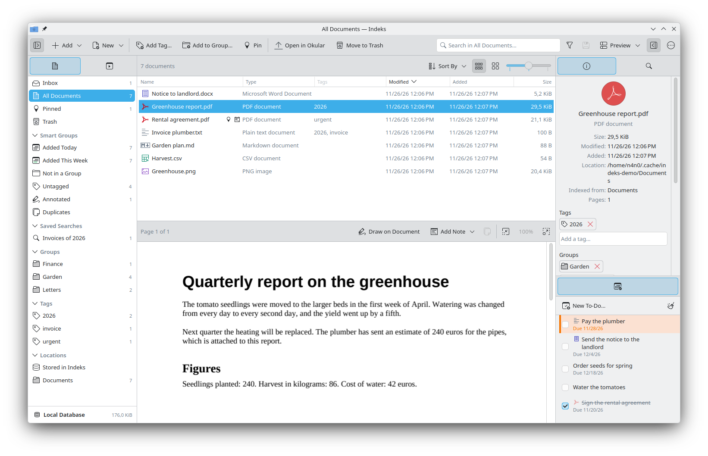

<!--
    SPDX-FileCopyrightText: 2026 n4n0
    SPDX-License-Identifier: CC0-1.0
-->

<p align="center">
  
</p>

# Indeks

A document manager for KDE Plasma in the spirit of DEVONthink and EagleFiler, built with
Qt 6, Kirigami and KDE Frameworks.



Indeks does not take your files away from where they are. It keeps an index of folders you
point it at – on this computer, on external drives, on servers – and lets you find, preview,
tag, group and annotate what is in them.

## What it does

- **Indexing in place.** A folder becomes an *indexed location*; its files become documents
  without being moved or copied. Local folders are watched, moved files keep their tags and
  notes, and locations can be on external drives or on servers (`sftp://`, `smb://`,
  `webdav://` …).
- **Finding.** File names, the text inside documents, your notes, and text recognised in
  pictures and scans, with a search language, stackable filters and saved searches.
- **Many kinds of documents.** Text, Markdown, source code, HTML, RTF, OpenDocument and
  Office files, PDF, pictures, e-mails and whole mailboxes, CSV and JSON, Obsidian canvases.
- **Organising.** An inbox for what is new, groups, tags, pins, and rules that file
  documents by themselves. Python scripts in a sandbox for what rules cannot say.
- **Annotating.** Comments, notes, sticky notes on pages, freehand drawing on PDFs and
  pictures.
- **To-dos.** A list with deadlines whose entries can point to documents.
- **Never destructive.** Indeks does not write to the files it indexes. Editing and drawing
  work on a copy; a file that is deleted elsewhere shows up in the trash instead of vanishing
  from the index.
- **Keyboard first.** `Ctrl+Alt+I` opens the command bar with every function.
- **Dolphin.** *Send to Indeks* in the context menu of folders.

## Documentation

- **The manual** describes everything Indeks does. It is built with Indeks
  (`build/doc/Indeks-Manual.pdf`) and opens from the application with *Indeks Manual* (`F1`).
  Its chapters are Markdown files in [`doc/manual`](doc/manual/).
- **Developer documentation** is in [`doc/developer`](doc/developer/):
  [architecture](doc/developer/architecture.md), [database](doc/developer/database.md),
  [development](doc/developer/development.md),
  [releasing](doc/developer/releasing.md) and
  [how the documentation is kept](doc/developer/documentation.md).

## Installing

Releases are published on the [releases page](https://github.com/n4n0GH/Indeks/releases)
as a Flatpak and as an AppImage.

- **Flatpak:** `flatpak install --user https://n4n0gh.github.io/Indeks/indeks.flatpakref`.
  It is kept up to date with your other Flatpaks.
- **AppImage:** download `Indeks-<version>-x86_64.AppImage`, make it executable and start
  it. AppImageUpdate, Gear Lever, AppImageLauncher and the like find newer releases.

The manual says what each of them brings along and what it leaves to the system.

## Building

```sh
cmake -S . -B build -G Ninja -DCMAKE_INSTALL_PREFIX=$HOME/.local
cmake --build build
ctest --test-dir build --output-on-failure
cmake --install build
```

To try Indeks without installing, run `build/bin/indeks`. What is needed to build and run is
listed in [doc/developer/development.md](doc/developer/development.md).

## Licence

GPL-2.0-or-later. Build files, metadata, documentation and this text are CC0-1.0. See
`LICENSES/`.
