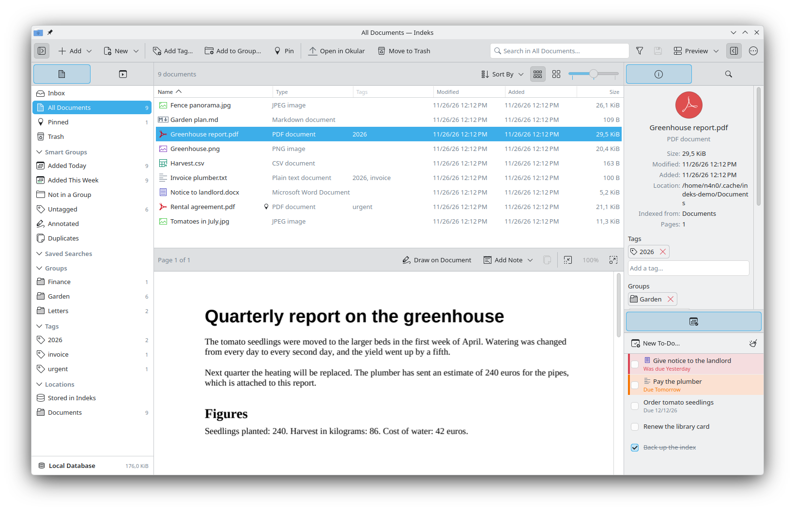

<!--
    SPDX-FileCopyrightText: 2026 n4n0
    SPDX-License-Identifier: CC0-1.0
-->

# Getting Started

Indeks is a document manager for KDE Plasma. It helps you find, organise and annotate your
documents wherever they are stored: in folders on this computer, on external drives and on
servers. This chapter explains the ideas behind it and takes you through the first steps.

## About this manual

The manual starts with overviews and ends with reference tables. You do not have to read it
from front to back: *Getting Started* and *Tasks* are enough to begin, and the later chapters
are there to look things up.

**Getting around.** The lines of the table of contents, and of the list at the start of each
chapter, can be clicked to go to that place. Your PDF viewer also shows the chapters and
their sections as bookmarks beside the pages.

**Conventions.** Names of buttons, menu entries and other parts of the window are set in
*italics*, for example *Add Tag…*. A path through menus is written with arrows: *New → New
To-Do…*. Keys are written like `Ctrl+T`. Things you type, such as searches, and names of files
are set in a `fixed-width` font.

> **Note:** Paragraphs like this one point out something that is easy to miss.

**Which version this is.** The cover says which version of Indeks the manual describes and
when it was last changed. The chapter *Changes* at the end lists what is new.

## What Indeks does

Most document managers want you to import your files into their own storage. Indeks does not.
It keeps an *index*: a record of your files, the text inside them and everything you attach
to them. The files stay where they are, and you keep using them with any other program.

- **Indexing in place.** You name the folders Indeks should know about. Their files become
  *documents* in Indeks without being moved or copied.
- **Finding.** You can search file names, the text inside documents, your own notes, and text
  that was recognised in pictures and scans.
- **Organising.** Documents can be put into groups, given tags, pinned, and collected by
  saved searches. New arrivals wait in an inbox until you have dealt with them.
- **Annotating.** Every document can carry a comment and notes. Notes can be stuck to a place
  on a page, and you can draw on PDFs and pictures.
- **Automating.** Rules tag and file documents by themselves. Scripts do what rules cannot.
- **Keeping track.** A to-do list with deadlines, where each entry can point to a document.

## Three principles

**Your files are never changed.** Indeks only reads the files it indexes. Tags, groups, notes
and drawings are stored in the index, not in the file. When you edit a text or draw on a
document, Indeks first makes a copy in its own folder and works on that; the original stays
as it was.

**Nothing disappears silently.** When a file is deleted outside Indeks, its document goes to
the trash in Indeks, where you can see that it went. A document you are working on stays in
the list in front of you until you move on.

**Everything is reachable from the keyboard.** `Ctrl+Alt+I` opens the command bar, which
lists every function of Indeks. Type a few letters of what you want and press `Enter`.

## Installing Indeks

Releases of Indeks are published at `https://github.com/n4n0GH/Indeks/releases` in two
forms. Both keep themselves up to date.

**Flatpak.** Install it with a software centre such as Discover from
`https://n4n0gh.github.io/Indeks`, or in a terminal:

```
flatpak install --user https://n4n0gh.github.io/Indeks/indeks.flatpakref
```

- It is updated together with your other Flatpak applications.
- It brings text recognition along, for English and German.
- It runs in a sandbox, which keeps some things out: Office documents are shown as their
  text instead of as they look, and Dolphin has no *Send to Indeks*.
- Scripts run with the Python that comes with the Flatpak. Python packages you installed on
  your system are not there for them.

**AppImage.** Download `Indeks-<version>-x86_64.AppImage` from the releases page, make it
executable and start it.

- Tools such as AppImageUpdate, Gear Lever and AppImageLauncher notice a newer release and
  fetch only what changed.
- It uses what is installed on your system for text recognition (Tesseract), for Office
  documents (LibreOffice) and for scripts (Python 3 and bubblewrap).
- Dolphin has no *Send to Indeks*; drag folders onto the window instead.

Indeks can also be built from its source; the file `README.md` there says how.

## First steps

### Starting Indeks

Start Indeks from the application menu. The first time, Indeks asks where its *database* is
to be: the folder in which it keeps its index, the documents you create in it and the copies
it makes for editing. Your files are not moved there.

- **Start a new database:** The folder shown is the usual place, `~/.local/share/indeks`. If
  you have no other in mind, leave it as it is and choose *Create Database*. *Choose…* opens
  at that folder and lets you pick another, on a second disk or a share for instance.
- **Open an existing database:** If you have a database already, on a share or brought along
  from another computer, choose its file `index.sqlite`, then *Open Database*.

*Quit* leaves without making anything; Indeks asks again the next time. See *Databases* for
more about both choices.

The window then opens with an empty list and the message *Nothing indexed yet*.

### Adding your first folder

1. Choose *Add → Add Indexed Folder…* in the toolbar, or press `Ctrl+O`.
2. Pick a folder, for example your `Documents` folder.

Indeks now reads the folder. The bottom of the left sidebar shows what it is doing; you can
keep working meanwhile. Documents appear in the list as they are read. The folder is listed
under *Locations* in the sidebar.

> **Note:** What is in a folder when you add it goes straight into the index. Only files that
> turn up later are also put into the inbox.

### Looking around



- The **sidebar** on the left chooses what the list shows: the inbox, all documents, a group,
  a tag, a saved search, a location.
- The **list** in the middle shows the documents of that place. Click a column title to sort.
- The **preview** below the list shows the selected document.
- The **side panel** on the right has two tabs: information about the selected document, and
  the to-do list.

### Finding something

Click into the search field (`Ctrl+F`) and type a word. The list narrows down to the
documents that contain it, in their name, their text or your notes. Under each name a line
shows where the word was found.

### Organising a document

Select a document and try the following:

- *Add Tag…* (`Ctrl+T`) gives it a tag.
- *Add to Group…* (`Ctrl+G`) files it into a group.
- *Pin* (`Ctrl+Shift+F`) marks it, so that it shows under *Pinned* in the sidebar.
- *Add Note…* in the bar above the preview (`Ctrl+Shift+M`) attaches a note.

You can also drag documents onto a group or a tag in the sidebar.

### Where to go from here

- *Tasks* shows how to use Indeks for typical jobs, such as dealing with scanned paper.
- *The Window* describes every part of the window.
- *Finding* explains searching in depth.
- The *Appendix* lists all keyboard shortcuts and search terms.

## A word about backups

The index holds work that exists nowhere else: your tags, groups, links, notes, drawings,
to-dos, rules, and the documents you created or edited in Indeks. Include the database folder in your
backups. For the local database that is `~/.local/share/indeks`; see *Databases* for others.

Your indexed files are not stored in the database. Back them up as you always have.
