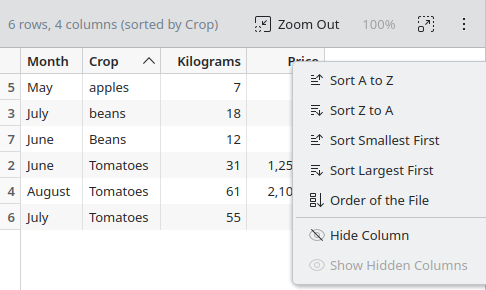

<!--
    SPDX-FileCopyrightText: 2026 n4n0
    SPDX-License-Identifier: CC0-1.0
-->

# Documents

A *document* in Indeks stands for a file: one in an indexed location, or one you created in
Indeks. This chapter describes the kinds of documents and how each is shown in the preview.

## General

Every document has a name, a type, a size, the times it was changed and added, and a
location. To these Indeks adds what you attach: tags, groups, a pin, links to other
documents, a comment, notes, drawings and to-dos.

**The preview.** Selecting a document shows it in the preview below the list. The bar above
the preview is always there. On its left it says a word about the document, such as its
number of pages. On its right are the things you can do with it, and at the end the zoom.

**Zoom.** Every kind of document can be shown larger and smaller: with the buttons in the
bar, with `Ctrl` and the mouse wheel, or with `Ctrl++`, `Ctrl+-` and `Ctrl+0`. The number
between the buttons shows the size; a click on it goes back to normal. Pictures and pages
start out fitted to the view. The size of text is remembered.

**Opening elsewhere.** *Open File* (`Ctrl+Return`) opens the document in its usual
application. *Open With…* lets you choose another one. *Show in File Manager* shows the file
in its folder.

## Plain text and source code

Text files are shown as text. Source code and data files get line numbers and syntax colours.
Lines that are too long wrap and continue below their own indentation.

- **Editing:** *Edit Text* (`Ctrl+E`) turns the preview into an editor. *Save* stores your
  changes in a copy that Indeks keeps; *Discard Changes* drops them; *Done* ends editing.
- **Long files:** Of a file larger than 4 MiB the preview shows the first 4 MiB. *Edit Text*
  loads the whole text.
- **Selecting and copying:** With the text in focus, `Ctrl+A` selects all of it and `Ctrl+C`
  copies the selection.

### Text files that are something else

A file called `.txt` is not always just text. Indeks looks at the beginning of a plain text
file and shows it as what it is written as:

- **Markdown:** A text with headings, links, bold words, code or a table in the marks of
  Markdown is shown formatted, like a Markdown document. The bar above the preview says so.
- **A table:** A text whose lines all have the same number of tabs, commas, semicolons or
  bars is shown as a table, like a CSV or TSV file.
- **A list with bars between spaces:** Lines of values with ` | ` between them
  (`who | when | what`) are a table too. A value may hold a bar that has no spaces around
  it. A line that is set in belongs to the row above it and is shown as one more column at
  the end: the text a row is about, below the row.

*Show Unformatted*, or *View Raw* for a table (`Ctrl+U`), in the bar above the preview
always shows the text as it is in the file; the same button goes back. *Edit Text* works on
the text as it is in the file too.

The guess is a careful one, so that a letter or a list does not lose its line breaks: a
text with one heading and nothing else stays text, and so do lines of settings that begin
with `#`, a list with a dash before each line, and fewer than three rows of values. Only
files that claim to be nothing but text are looked at this way. A file that says what it is
by its name, `.md` or `.csv`, is taken at its word.

## Markdown and HTML

Markdown and HTML documents are shown formatted. *Show Unformatted* (`Ctrl+U`) in the bar
above the preview shows the source instead. A plain text file that is written in Markdown
is shown the same way; see *Text files that are something else* above.

*Edit Text* works on the source of a Markdown document. An HTML document that is shown
formatted is edited as it looks.

## PDF

PDF documents are shown page by page. The bar above the preview says which page is in view.

- **Selecting text:** Drag with the mouse to select text. The drag can start and end anywhere
  on the page, also in the margin; the nearest text counts. A double click selects a word. A
  single click removes the selection. `Ctrl+C` or the copy button copies it. `Ctrl+A` selects
  the text of the page in view. A selection stays on one page.
- **Search hits:** Coming from a search, the places where the word was found are marked.
- **Drawing and notes:** See *Organising → Drawing* and *Sticky notes*.

### Scanned pages

A scanned page is a picture of text. Indeks recognises the text (see *Settings → Text
Recognition*), and notes where each word stands on the page. So a scan is searched like any
other document, and its text can be selected on the page itself:

- **Selecting, copying:** As on other pages: drag, double-click a word, `Ctrl+A`, `Ctrl+C`.
  A selection is always whole words. Indeks knows where a word begins and ends, not where
  its letters do.
- **Search hits and finding** work as on other pages; see *Finding → Finding inside a
  document*.
- **Show Recognized Text** (`Ctrl+U`), in the bar above the preview, shows the text that was
  recognised in place of the pages: to read it, to see what recognition made of the scan,
  and to copy longer stretches. The same button brings the pages back.

In a PDF of which some pages are scans and others are not, each page is treated as what it
is.

> **Note:** What is recognised is as good as the scan. A word that was read wrongly is
> selected, copied and found as it was read. *Show Recognized Text* shows what that is.

A scan whose text was recognised by an earlier version of Indeks, which did not keep where
the words stand, is read once more when you first look at it, in the background; its text
can be selected a moment later.

## Pictures

Pictures are shown fitted to the preview. The bar says their size in pixels. You can zoom,
draw on them and stick notes to them.

Text in a picture, a photo of a receipt or a screenshot for instance, is recognised like
that of a scanned page, and can be selected, copied, found and shown the same way; see *PDF
→ Scanned pages* above.

## Office documents

Word, Excel and PowerPoint files in old and new formats, OpenDocument files and RTF are shown
as they look, if LibreOffice is installed. Indeks has LibreOffice make a PDF of the document
and shows that, so everything that works on a PDF works here too: selecting text, drawing and
sticky notes.

- The PDF is kept in the cache and removed 90 days after it was last looked at. The document
  itself is only read.
- LibreOffice runs without a window and, where bubblewrap is installed, without access to the
  network.
- Without LibreOffice, Office documents are shown as the plain text Indeks found in them, and
  files in the formats from before 2007 (`.doc`, `.xls`, `.ppt`) are found by name only.

## E-mail

A message saved as an `.eml` file is shown with its subject, sender, recipients and date,
followed by its text and its attachments.

- **Long lists of recipients:** *To*, *Cc* and *Bcc* take one line each. A button such as
  *Show All 70* opens a line that holds more.
- **Formatted messages:** *Show Formatted* switches between the plain and the formatted
  version of a message. Pictures and other content from the network are never loaded.
- **Attachments:** Click an attachment to open it, or to add it to Indeks as a document
  with *Add to Indeks*. The new document is a copy in the folders of Indeks. It arrives in
  the *Inbox* and is linked to the message it came in: the *Information* tab of either lists
  the other under its linked documents, and a click there goes to it. See *Organising →
  Linked documents*.

## Mailboxes

A mailbox file (mbox) opens like a folder. Click the arrow before its name, or press the
right arrow key, to list its messages below it. Each message is a document: it is found by
its own words and can be tagged, grouped, pinned, annotated, matched by rules and handed to
scripts.

- **Where messages are listed:** Under their mailbox, and wherever something of their own
  finds them: a search for words, a tag, a group, a pin, a note, the inbox. Lists that go by
  place, type, size or date alone show the mailbox and not the messages in it.
- **Large mailboxes:** A mailbox is never loaded into memory, so its size does not matter. An
  opened mailbox lists up to 20,000 messages; a line above the list says when there are more.
  Searching finds all of them.
- **When the mailbox changes:** After mail was added or deleted, only new messages are read.
  What you attached to the others stays with them.
- **Nothing is written:** The mailbox file is only read.

## Tables: CSV and TSV

Files of values in rows and columns are shown as a table, with the column names at the top,
numbers aligned to the right and the rows numbered as in the file.

- The separator (comma, semicolon, tab or bar) is detected from the first lines. Bars that
  stand between spaces (` | `) separate without the spaces becoming part of the values.
- *Column Names* switches whether the first row is treated as names.
- Drag the line between two column names to change a column's width.
- Click a cell to make it current; the arrow keys move on from it and `Ctrl+C` copies it.
- *View Raw* (`Ctrl+U`) shows the file as text.

**Sorting rows and hiding columns.** Right-click the name of a column, or a cell:

- **Sort A to Z**, **Sort Z to A:** Puts the rows in the order of the text in that column,
  as a dictionary would, whatever its case.
- **Sort Smallest First**, **Sort Largest First:** Offered for a column of numbers; goes by
  the numbers, also where they are written with a currency, a percent sign or digits in
  groups (`1,250.50`).
- **Order of the File:** Back to the rows as they are in the file.
- **Hide Column** takes the column out of view; **Show Hidden Columns** brings all back.
- **Copy Cell**, in the menu of a cell, copies what the cell holds.

A click on the name of a column sorts by it too: once upwards, again downwards, a third time
back to the order of the file. An arrow beside the name shows which way. Cells that are
empty, or hold no number where numbers are sorted, come last either way.

The numbers at the left are the lines of the file, and stay with their rows wherever those
are sorted to. The bar above the table says what it is sorted by and how many columns are
hidden. None of this changes the file, and it is not kept: the next time the table is shown,
it is shown as it is in the file.

Of a file larger than 48 MiB the table shows the beginning. A plain text file that holds
such values is shown as a table too; see *Text files that are something else* above.

## JSON and JSON Lines

JSON Lines files (`.jsonl`, `.ndjson`) and JSON written without line breaks are laid out for
reading: every record is indented with one member per line and can be folded. *Fold All*
turns the file into a list of one-line summaries. Large files show their first 500 records
until you click *Show More*. *View Raw* shows the file as it is.

This is a view only. Nothing in the file is rewritten.

## Obsidian canvases

`.canvas` files are shown as the board they are: text cards, groups, link cards, file cards
and the connections between them. Drag to move around, use `Ctrl` and the wheel to zoom.

- A double click on a file card jumps to that document in Indeks.
- A double click on a link card opens the link after you confirmed where it leads.
- The words on the cards are searchable.
- Canvases are displayed, not edited.

## Websites

A website is a document that holds the address of a page on the web and nothing else.
Nothing of the page itself is stored, and Indeks does not go to the internet for it.

- **Opening:** A double click or *Open in …* (`Ctrl+Return`) shows the page in the browser of
  your desktop.
- **The preview** shows the address, so that you can read where it leads before you go
  there. *Copy Web Address*, there and in the context menu, puts it on the clipboard.
- **Finding:** `kind:website` lists the websites, and so does *File Type → Websites* in the
  filter bar. A search finds a website by its name and by the words of its address.
- **Organising:** Tags, groups, pins, comments, notes, links to other documents, to-dos and
  rules work as with every document.

To make one, copy the address of the page in your browser and choose *New → New Document from
Clipboard…*; see *Documents created in Indeks → From the clipboard*. Indeks stores it as an
internet shortcut, a small `.url` file that other programs and other systems open too.

Internet shortcuts (`.url`) and the link files of macOS (`.webloc`) in an indexed location
are websites as well. A shortcut to something that is not on the web, a folder for instance,
has no address to show and opens like any other file.

> **Note:** A link file that was indexed by an earlier version is shown as before until it
> changes or you choose *Read Again* in its context menu.

## Documents created in Indeks

*New → New Plain Text Document…*, *New Markdown Document…* and *New Formatted Document…*
create a document that is stored in Indeks' own folder. Such documents can be renamed (`F2`).
They start out in the inbox.

### From the clipboard

*New → New Document from Clipboard…* (`Ctrl+Shift+V`) makes a document of what you copied in
another program: a passage of a web page, a few lines of a letter, a screenshot. The dialog
shows what is on the clipboard and asks for a name. For text it offers the first line.
The address of a page can be kept the same way.

- **The address of a website,** copied alone, becomes a website: a document that holds the
  address and opens the page in your browser. It is named after the address unless you type
  another name. See *Websites* above.
- **Text** becomes a plain text document or a Markdown document.
- **Formatted text,** copied in a browser or an office program, can also become a formatted
  document. That keeps headings, bold type, lists, tables and links. Pictures within the
  text are not taken along, and neither is anything else that would be fetched from the
  internet when the document is shown.
- **A picture** becomes a PNG file. Text in it is recognised for searching, as in every
  picture.
- **More than one of these:** Where the clipboard holds text and a picture, as it does after
  copying cells of a spreadsheet, choose under *Create a* what the document is to be.

What the dialog shows is what is stored, also when you copy something else while it is
open. If the clipboard holds neither text nor a picture, Indeks says so and no dialog
appears.

> **Note:** Files that were copied in a file manager do not become documents this way.
> Files come into Indeks through indexed locations; see *In and Out → Folders,
> not single files*.

## Documents that cannot be read

If the program that reads files gives up on a file, the document is still added, by its name.
The side panel says that its content could not be read. *Read Again* in the context menu
tries once more.
