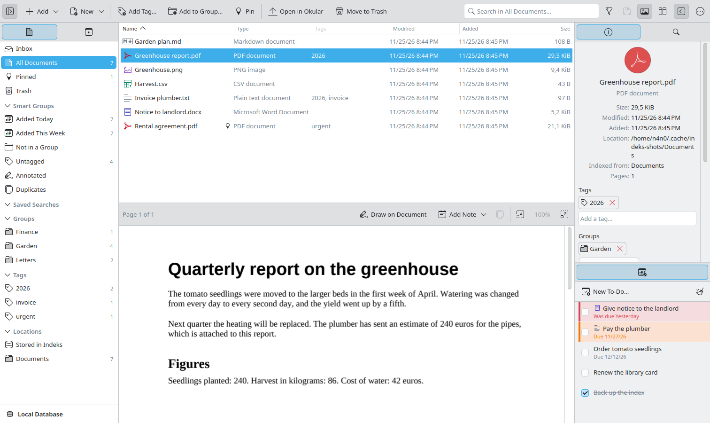
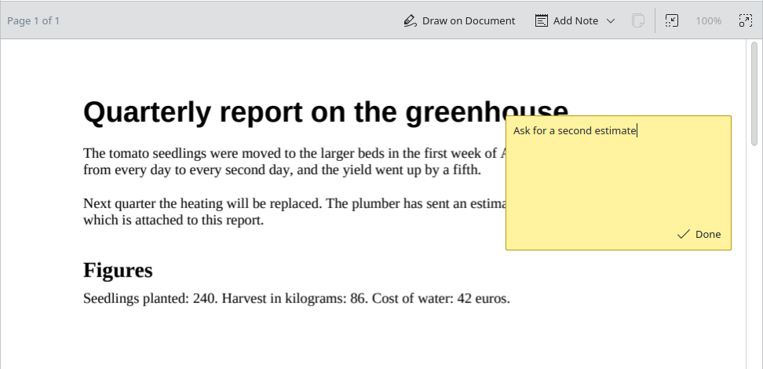
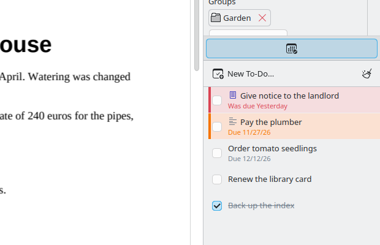
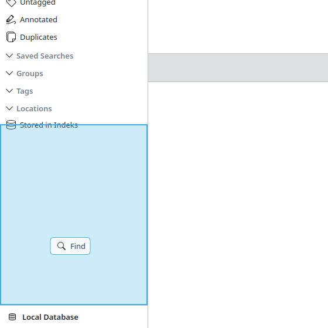
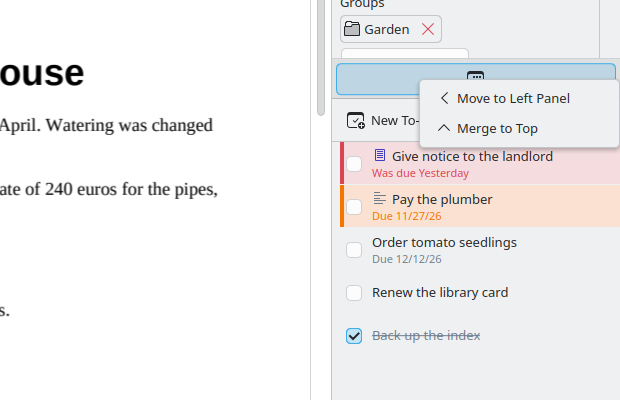
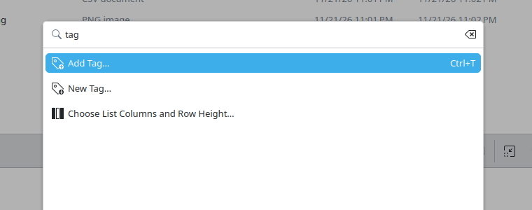

<!--
    SPDX-FileCopyrightText: 2026 n4n0
    SPDX-License-Identifier: CC0-1.0
-->

# The Window

Indeks has one window. It is divided into the toolbar at the top, the sidebar on the left,
the list of documents with the preview in the middle, and the side panel on the right.

## Toolbar

From left to right, the toolbar holds at first:

- **The sidebar button** (`Ctrl+B` or `F9`), which shows and hides the sidebar.
- **Buttons for commands:** *Add*, *New*, *Add Tag…*, *Add to Group…*, *Pin*, *Open File* and
  *Move to Trash*.
- **The search field** (`Ctrl+F`). See *Finding*.
- **The filter button** (`Ctrl+Alt+F`), which opens the filter bar, and *Save Search…*.
- **The preview button** (`F10`), and beside it the button that puts the preview beside the
  list or below it; see *Preview*.
- **The side panel button** (`Ctrl+Shift+B` or `F11`).
- **The menu**, which holds every command, sorted into *Go*, *Document*, *Preview*, *Sidebar*
  and *Scripts*.

The sidebar button, the side panel button and the menu keep their places. Everything
between them is yours to arrange, the search field included.

**The Add menu.** *Add Indexed Folder…*, *Add Remote Location…*, *Add Database…* and *New
Database…*.

**The New menu.** New plain text, Markdown and formatted documents and *New Document from
Clipboard…*; *New Group…*, *New Tag…*, *New Rule…* and *New Script…*; and *New To-Do…*.

**Arranging the toolbar.** Right-click the toolbar and choose *Configure Toolbar…*. See
*Settings → Toolbar*. Buttons that do not fit the window move into a menu.

## Sidebar

The sidebar is the panel on the left. It has tabs at its top, shown by their icons: at
first *Database* and *Automation*. `Ctrl+B` or `F9` shows and hides it. Which tabs it has is
yours to say; see *Arranging the panels* below.

### The Database tab

This tab chooses what the list shows. Its sections can be folded with the arrow before
their title. The numbers on the right count the documents in each entry. They are worked
out in the background: in a large database they follow a change a moment later, and after a
database was opened they appear a moment after the entries.

- **Inbox:** Documents that still need your attention.
- **All Documents:** Everything in the open database.
- **Pinned:** Documents you pinned.
- **Trash:** Documents you removed, and documents whose file went away.
- **Smart Groups:** *Added Today*, *Added This Week*, *Not in a Group*, *Untagged*,
  *Annotated* and *Duplicates*. *Missing Files* appears when there are any.
- **Saved Searches:** Searches you saved. See *Finding*.
- **Groups:** Your groups, with groups inside groups indented.
- **Tags:** Your tags.
- **Locations:** *Stored in Indeks*, which lists documents created in Indeks, and the indexed
  folders and servers. A location that cannot be reached is marked.

**Context menus.** A right-click on an entry offers what can be done with it: *Edit…*,
*Delete…*, *New Subgroup…*, *Update Now*, *Empty Trash…*, *Save Search…*. A right-click on a
section title offers to make a new entry of that kind.

**Dropping.** Documents dragged from the list can be dropped onto a group, a tag, the inbox
or the trash.

### The Automation tab

This tab has two entries, *Rules* and *Scripts*, with the number of each. A click on the
tab or on one of the two makes the middle of the window about them instead of about
documents:

- **The list** shows the rules or the scripts of the open database, where the documents are
  listed otherwise.
- **Where the preview is**, the rule or script that is selected in the list is shown and can
  be changed. *Save* in the bar above it stores the changes.

`Ctrl+5` goes to the rules and `Ctrl+6` to the scripts. The *Database* tab, an entry of
it, a search, or any of the commands that go to documents, such as *Go to Inbox*, brings
the documents back. What you were changing stays as it was until you return. See
*Automation*.

Commands and keys for documents rest while the middle of the window is about rules or
scripts: `Del` removes the selected rule or script then, not a document.

**The database button.** The bottom of the sidebar names the open database. A click lists
the others; a right-click offers *Rename Database…*, *Databases…*, *Add Database…* and *New Database…*.

**The activity display.** While Indeks opens a database, reads files, recognises text,
fetches remote files or runs scripts, a line above the database button says what it is
doing. A click on it lists the file being worked on and everything that waits.

The database button and the activity display stand at the bottom of the panel that has the
*Database* tab, should you move that tab to the other side.

*Opening database…* stands there, with the name of the database, from the moment the window
comes up or another database is switched to until its list of documents and the numbers in
the sidebar are there. In a small database that is over before it can be read; in one of
some hundred thousand documents it takes a few seconds, the first time after the computer
was started most of all. The window can be used meanwhile.

*Listing documents…* stands there, with the name of the entry, when a list takes more than a
moment to come: the duplicates among some hundred thousand documents take about a second.
What the list showed before stays, dimmed, until the new one is there. A search through the
text of all documents that takes that long says *Searching…*.

## List of documents

The list shows the documents of the entry selected in the sidebar, narrowed down by the
search field and the filters.

**Selecting.** Click a document to select it. `Ctrl`-click adds or removes one, `Shift`-click
selects a range, `Ctrl+A` selects all. The arrow keys, `Page Up`, `Page Down`, `Home` and
`End` move the selection.

**Sorting.** Click a column title to sort by it; click again to turn the order around.

**Marks in a row.** A pin marks a pinned document, a note sign one with a comment, notes or
drawings. A struck-out name with a warning sign means the file is missing. A faded row with
its name in italics is a document that no longer belongs in this list; see *Organising →
Documents stay in view*.

**Mailboxes.** A mailbox has an arrow before its name. Click it, or press the right arrow
key, to list its messages below it. The left arrow key closes it again.

**The context menu.** A right-click on a document offers the commands for it: opening,
tagging, grouping, pinning, notes, to-dos, linked documents, editing, text recognition,
scripts, inbox and trash.

**Dragging.** Documents can be dragged onto the sidebar and into other applications. A folder
dragged in from elsewhere becomes an indexed location; single files are not taken.

### Columns

Right-click the column titles, or choose *Choose List Columns and Row Height…* from the menu,
to say what the list shows beside the name: *Type*, *Tags*, *Groups*, *From*, *Location*,
*Comment*, *Pages*, *Modified*, *Added* and *Size*.

- **Order:** Drag a title sideways to move its column. The other columns step aside.
- **Width:** Drag the line before a title to make its column wider or narrower.
- **Too many columns:** If more columns are chosen than fit, all of them shrink a little.
  Only when that is not enough are some left out, and the menu says how many.
- **Row height:** *Compact*, *Normal* or *Tall*.

**Every view has its own columns.** The inbox can show other columns than a group, a tag or a
saved search. The menu names the view it is for.

- A view you have not chosen columns for shows the standard ones.
- Ticking or moving a column changes the view you are looking at, and no other.
- *Use Standard Columns Here* takes a view back to the standard.
- *Use These Columns in All Views* makes what you see the standard for every view.
- *Reset Columns and Rows in All Views* returns everything to how it was at first.

Column widths and the row height are the same in every view.

## Preview

The preview shows the selected document. `F10` shows and hides it. Drag the border between
list and preview to change its size.

**Below or beside the list.** The preview stands below the list at first. The button beside
the preview button in the toolbar, or *Menu → Preview → Preview Beside the List*, puts it to
the right of the list instead, which suits a wide screen: the list keeps its full height, and a page is shown larger. Choose it again to have
the preview below. Indeks remembers the choice.

- Beside the list the preview takes half of the room until you drag the border.
- The list is narrower then. If its columns no longer fit, some are left out; see *List of
  documents*.
- Choosing it while the preview is hidden shows the preview.

**The bar above the preview** is always there:

- On the left, a word about the document: pages, pixels, rows, or a hint.
- *Edit*, which is called *Edit Text* for text documents and *Draw on Document* for PDFs,
  pictures and Office documents (`Ctrl+E`).
- *Add Note…* (`Ctrl+Shift+M`). On PDFs, pictures and Office documents this is a button
  with a menu: *Add Note…* for a note on the whole document and *Add Sticky* for a note
  stuck to a place.
- What the viewer of this kind of document offers, such as *Copy Selected Text*.
- *Show Unformatted* or *View Raw* (`Ctrl+U`), where a document is laid out for reading.
- The zoom.

Buttons that do not fit move into a menu at the end of the bar.

## Side panel

The side panel is the panel on the right. At first it has two areas, one above the other,
each with its tabs at the top: *Information* and *Find* above, and *To-Do* below.
`Ctrl+Shift+B` or `F11` shows and hides the panel. Which tabs it has, and in which area, is
yours to say; see *Arranging the panels* below.

### Information

This tab shows what Indeks knows about the selected document.

- **Facts:** Name, type, size, when it was modified and added, where it is, which location it
  belongs to, and metadata found in the file, such as the author or the number of pages.
- **Tags:** Type into the field to add a tag; click the cross on a tag to remove it.
- **Groups:** The groups the document is in, with a button to add it to another.
- **Linked Documents:** The documents this one is linked to. Click a name to go to that
  document; the button beside it removes the link. *Manage Linked Documents…* finds
  documents to link. See *Organising → Linked documents*.
- **Comment:** A free text about the document. Comments are searchable.
- **Notes:** The notes on the document, with a button to add one. A note that is stuck to a
  page says so; a click on *On page 3* turns to that page.
- **Messages:** A warning when the file is missing or the location is not connected.

With several documents selected, the tab offers to tag and group all of them at once, and
to link them with one another.

### To-Do

This tab is the list of things to do. It has the lower area of the side panel to itself at
first, so that the list stays in view while the tabs above it change. See
*Organising → To-dos*.

### Find

This tab, with the magnifying glass, searches within the document that is shown in the
preview: a field for what to find, the number of places it stands at with arrows to step
through them, and those places as a list. See *Finding → Finding inside a document*.

## Arranging the panels

The tabs of the sidebar and the side panel are not tied to their panel. Each of the five,
*Database*, *Automation*, *Information*, *To-Do* and *Find*, can be put into either panel,
and each panel can show two of them at once, one above the other.

**Drag a tab** to where its view is to be. While you drag, the place the view would take
is marked:

- **Along its row of tabs:** A line shows between which tabs it goes. This is how the tabs
  are put in order.
- **Onto another row of tabs, or the view below it:** The tab joins the tabs of that area,
  in the other panel or the other area of its own.
- **Onto the lower part of a panel** that has only one area: The tab gets an area of its
  own there, below the others.
- **To the edge of the window** where a panel is hidden or has no tabs: A strip appears
  there while you drag; the tab goes into that panel, and the panel is shown.

**Or right-click a tab:**

- **Move to Right Panel**, **Move to Left Panel:** Puts the tab into the other panel, as
  the last tab of its upper area.
- **Split Below:** Gives the tab the lower area of its panel: a second row of tabs with its
  own view below it. Further tabs that you split below join it there. The last tab of the
  upper area stays where it is.
- **Merge to Top:** Puts a tab of the lower area back among those of the upper one. When
  the last one has gone, so has the lower area.

Drag the line between the two areas to say how much of the panel each gets. A panel without
tabs is not shown.

The same commands are in the command bar, with the name of the tab in them, such as *Move
To-Do to the Left Panel*, *Split Find Below in Its Panel* or *Move the Find Tab One Place to
the Left*. *Reset Sidebar and Side Panel* puts everything back where it was at first. Indeks remembers the arrangement, and which tab
each area shows.

## Command bar

`Ctrl+Alt+I` opens the command bar. It lists every function of Indeks. Type a few letters of
a command's name and press `Enter` to run it.

Every script has an entry of its own there, *Run Script “name”*.

## Messages

Indeks reports what it did in short messages at the bottom of the window, for example that a
rule was applied or that files went to the trash. They go away by themselves.
