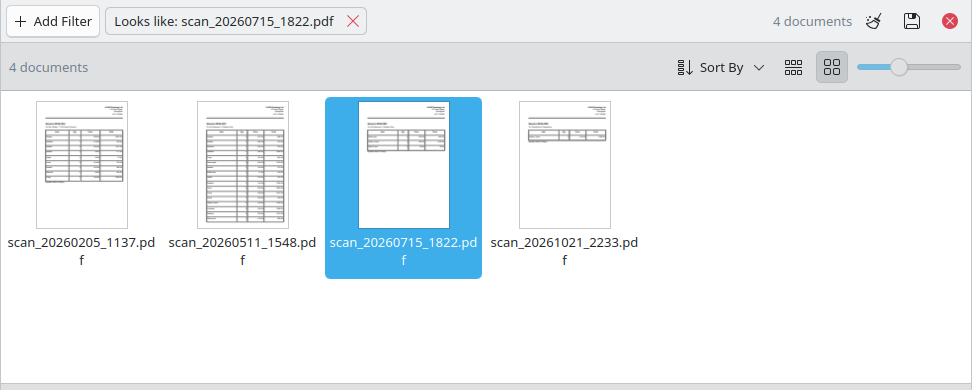
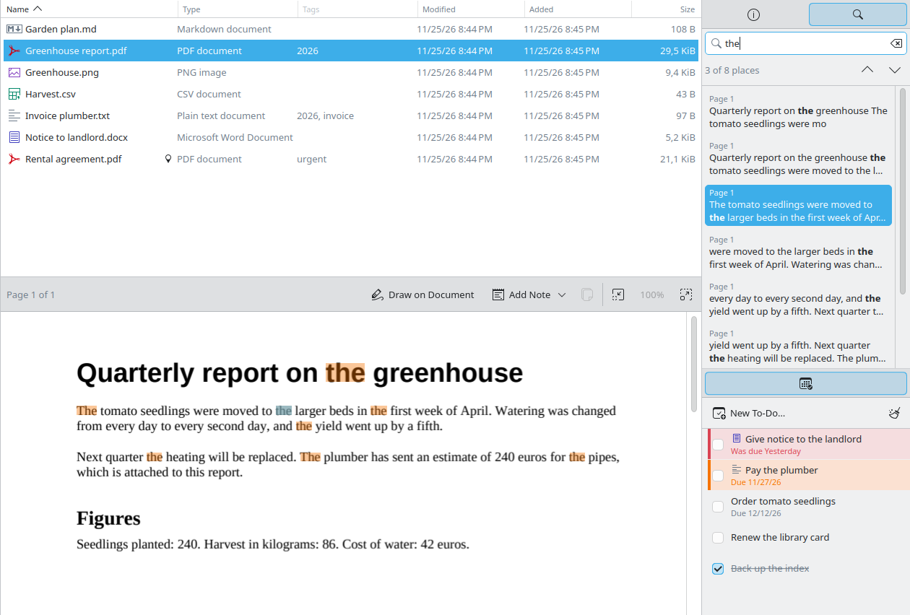

<!--
    SPDX-FileCopyrightText: 2026 n4n0
    SPDX-License-Identifier: CC0-1.0
-->

# Finding

Everything in Indeks can be searched: file names, the text inside documents, your comments
and notes, and text recognised in pictures and scans.

## The search field

Click into the search field or press `Ctrl+F`, and type. The search looks in the place that
is selected in the sidebar; the field says which, for example *Search in Inbox…*.

- **Words** match names, text and notes. A word also matches the beginning of a longer word:
  `pine` finds *pineapple*.
- **Several words** must all be found.
- **A phrase** in quotes is found as written: `"analytical engine"`.
- **A minus** in front excludes: `-draft`.
- **OR** between two terms finds either: `invoice OR receipt`.

The search starts by itself shortly after you stop typing. Under each found document a line
shows where the word occurs. Selecting a document opens the preview at the first hit.

> **Note:** Searching the text of a very large index for a very short word can take a few
> seconds. A line runs along the top of the list meanwhile, and you can keep typing.

## Search terms

Besides words, a search can hold terms that ask for a property. They can be mixed freely with
words and with each other.

| Term | Finds |
| --- | --- |
| `tag:invoice`, `tag:"two words"` | documents with that tag |
| `tag:none` | documents without any tag |
| `group:Taxes` | documents in that group |
| `group:none` | documents in no group |
| `kind:text` `kind:rich` `kind:pdf` `kind:image` `kind:email` `kind:canvas` `kind:website` | documents of a kind |
| `ext:md` | by file name extension |
| `name:report` | a word in the name only |
| `name:*.pdf`, `name:scan_??.png` | a pattern for the whole name: `*` any characters, `?` one |
| `path:Invoices/2026` | part of the path of the folder the file is in |
| `source:Documents` | documents of an indexed location |
| `content:word` | the word in the text only |
| `note:word` | the word in notes and comments only |
| `added:today`, `added:7d`, `added:12h` | added today, in the last 7 days, in the last 12 hours |
| `modified:>2026-01-31`, `added:2026-03` | changed after a day; added in a month |
| `size:>5M`, `size:<200k` | by size |
| `is:inbox`, `is:pinned`, `is:annotated`, `is:linked` | by what you did with them |
| `is:unfiled`, `is:untagged` | in no group; without tags |
| `is:duplicate` | files with the same content as another |
| `is:missing`, `is:trashed` | file is gone; in the trash |
| `is:local`, `is:copied`, `is:ocr` | stored in Indeks; has a working copy; text was recognised |

The same language is used for saved searches and for rules. The *Appendix* has the complete
list.

## The filter bar

The filter button beside the search field (`Ctrl+Alt+F`) opens the filter bar above the list.
There you put a search together by picking, without typing terms.

- *Add Filter* offers: name, text in the document, text in notes and comments, folder,
  extension, file type, date modified, date added, size, tag, group, location, state, and
  what looks like the selected document; see *Documents that look alike*.
- Each filter you add shows as a chip and narrows the list at once. Click the cross on a chip
  to remove it; click a typed chip to change it.
- Lists of choices show how many documents each choice would leave.
- *Modified Between Dates…*, *Added Between Dates…* and *Other Size…* take values that are
  not in the lists.

Several tags or states can be on at once, and all must apply. Of file type, size, each date,
location and looks there is one at a time; picking another replaces it.

The filters add to what is typed in the search field. Closing the bar removes all filters.

## Saved searches

*Save Search…* (`Ctrl+Shift+S`) keeps the current search, with its filters, under a name. It
appears under *Saved Searches* in the sidebar and always shows what matches at the moment.

The dialog lists what the search is made of, one filter to a line, the way the conditions of
a rule are listed: the place that is selected in the sidebar, what is typed in the search
field, and each filter of the filter bar.

- **Add Filter** offers the filters of the filter bar, and *Search Words…* for words as you
  would type them into the search field, search terms included.
- **The pencil** on a line changes a filter that was typed in; **the cross** takes a line
  off.
- **Below the list** stands how many documents the filters find at the moment.

To change a saved search, right-click it and choose *Edit…*, or select it and choose *Edit
Selected Sidebar Entry…*. The same dialog opens with the filters the search was saved with. A search from an earlier
version of Indeks is taken apart into filters as far as that goes; what is left over, and a
search that uses `OR` or excludes something with a minus, stands in one *Search* line and is
changed as text. *Delete…* removes a saved search; the documents it found are not affected.

## Documents that look alike

Scanners and web shops name files as they please, and a folder of `scan_0412.pdf` and
`document(7).pdf` cannot be sorted by name. But the invoices of one sender look alike: the
same letterhead, the same logo at the same place. Indeks can go by that.

Select a PDF or a picture and choose *Find Similar-Looking Documents* from its context menu
or the command bar. The filter bar opens with the filter *Looks like: name*, and the list
shows the documents that look like the selected one, itself among them:

- **Pages are compared by their head.** A page is anything light with something on it: a
  letter, an invoice, a form, a scan of one, as a PDF or as a picture. What counts is its
  upper quarter, where letterhead and logo are. What stands below, and how much of it, does
  not matter: an invoice of three lines is like one of thirty from the same sender. Of a
  PDF the first page is looked at.
- **Pictures are compared as a whole.** A photograph is like the same photograph in another
  size, lighter or darker, or saved in another format. So is a page with next to nothing in
  its upper quarter.
- **A page is never like a picture.**
- **Find Roughly Similar-Looking Documents** takes it less strictly. Use it when too little
  is found: for scans that sit askew, or a letterhead that changed a little over the years.
  It also finds more that does not belong.
- **Does Not Look Like …**, in the *Add Filter* menu, turns it around: everything in the
  list that does not even roughly look like the selected document. That finds the odd ones
  in a folder of documents that should all be of one kind.

The filter is one like any other. It narrows the list you are looking at, so select *All
Documents* in the sidebar to search everywhere. Further filters go with it, *File Type: PDF*
or a date for instance, and *Save Search…* keeps it: a saved search *Invoices of the
plumber* then lists every such invoice that comes in. In a rule the filter stands among the
conditions like the others, added from the selected document with *Add Filter*; see
*Automation*.

What then? Select all that was found (`Ctrl+A`) and give it a tag or a group.

The filter goes by the document it was made from, not by a description of it. If that
document leaves the index, a saved search or a rule that uses it finds nothing any more;
make the filter anew from another document of the kind.

> **Note:** Indeks goes by where there is something on the page, not by what it says. Two
> letters set the same way by different people look alike to it, and one sender's invoice
> looks different after a new design. Look through what was found before you act on all of
> it.

What a document looks like is noted when it is read for the index. For the pictures and
PDFs that were in the index before Indeks did this, it is made up for in the background
after the start; the activity display says *Looking at documents* meanwhile, and a search
for similar documents finds more as that goes on. Only pictures and PDFs take part, and of
those only the ones whose file can be read on this computer: files on a server take part
once Indeks has fetched them for indexing.

## Smart groups

The smart groups in the sidebar are searches that come with Indeks:

- **Added Today**, **Added This Week:** What is new.
- **Not in a Group**, **Untagged:** What is not organised yet.
- **Annotated:** Documents with a comment, notes or drawings.
- **Duplicates:** Files with the same content as another file in the index.
- **Missing Files:** Documents you restored although their file is gone. This entry is only
  there when there are any.

## Finding inside a document

Coming from a search, the preview marks the search words in the document and opens at the
first hit: in text, on the pages of a PDF and in the cells of a table.

To look for something else in the document that is shown, choose *Find in Document…*
(`Ctrl+D`), or click the magnifying glass at the top of the side panel. This is the *Find*
tab of that panel:

- **Type what to find.** It is looked for as you type, whatever its case, and the preview
  goes to the first place it stands at. All places are marked in the document.
- **Step through the places** with `Enter` and `Shift+Enter` in the field, with the arrows
  beside the number of places, or with `F3` and `Shift+F3` from anywhere in the window. After
  the last place comes the first again.
- **The list below** names the places with the words around them, and the page, line or
  cell each is at. A click goes there. It lists the first 300; the arrows reach all.
- **Another document** you select starts with an empty field: the search is for the
  document it was typed for.

Text, Markdown and HTML, tables, PDF documents, Office documents and e-mails can be
searched this way; in an e-mail, the text of the message is. So can scanned pages and
pictures in which text was recognised: the places are marked on the scan itself. In a PDF
with scanned pages and others, the places on the scanned pages are listed after the others.
Canvases and websites have no text in the preview to search. A text cannot be searched while
you are editing it.
The marks go away when you leave the *Find* tab.
